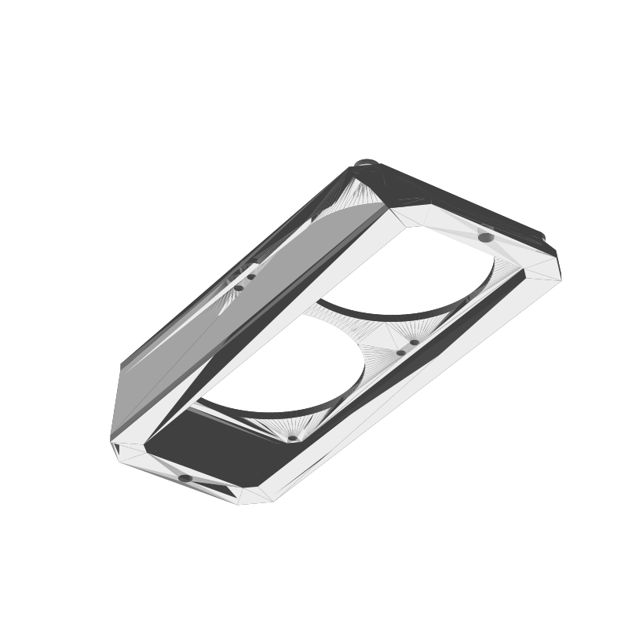
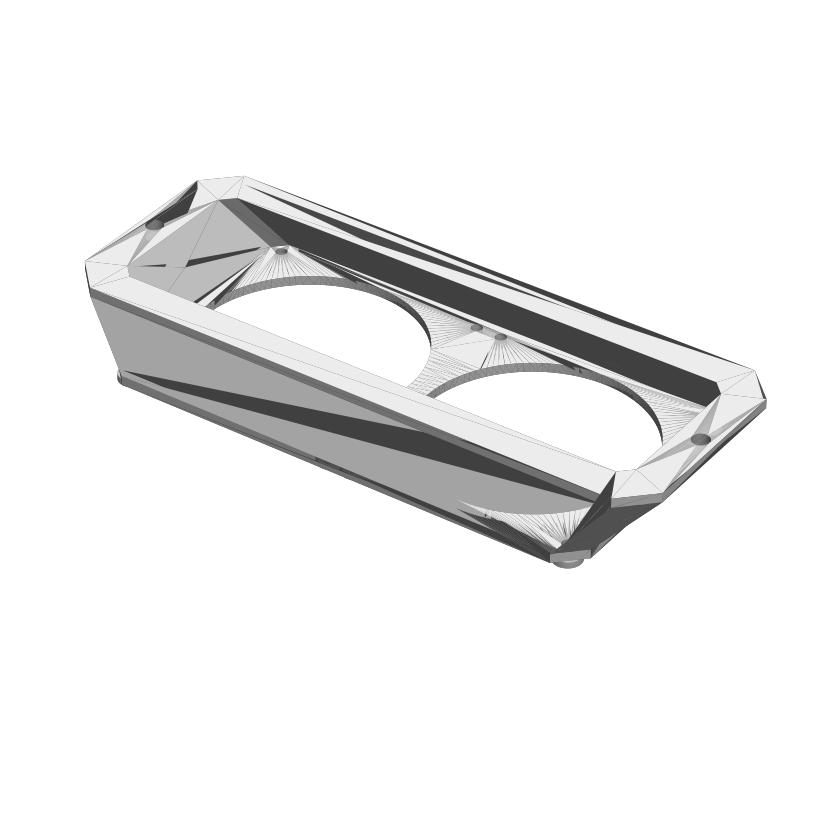

# Dual 80 mm fan mount for a 10" rack roof

3D-printable mount that holds **2× Arctic P8 PWM PST (80 × 80 × 25 mm)** side by side under the **180 × 55 mm cable entry slot** in the roof of a **DSIT DS10-3415** (10", 15U) rack. The fans blow up and out through the slot.

It mounts only on the two existing threads of the slot cover plate (190 mm apart). The cover plate is removed. No cutting or drilling on the rack.

## Files

| File | Use |
|---|---|
| `dual-80mm-fan-mount.stl` | Print this. Already oriented: fan side down on the bed. |
| `dual-80mm-fan-mount.step` | For editing in CAD. |

## Measure before you print

The design is based on measurements of one rack. Check these on yours:

1. Roof slot is 180 × 55 mm.
2. Cover plate threads are 190 mm apart, centered on the slot width.
3. Thread size M4 or M5 (the 5.5 mm ear holes fit both, use a washer).
4. At least ~51 mm free height under the roof (part 26 mm + fan 25 mm), plus room for the fan cable.
5. The flange (199.5 × 73 mm) does not hit vents or other parts on the roof.

## Print settings

- PETG or ASA, 0.4 mm nozzle, 0.2 mm layers
- No supports needed (all walls ≤ 44°)
- ≥ 6 perimeters (2.4 mm walls), 25 % gyroid infill
- Size 199.5 × 84.8 × 26 mm, about 109 g PETG. Fits a 200 × 200 mm bed with very little margin.

## Assembly

1. Stick a ~9 × 2 mm foam sealing strip around the top of the flange.
2. Remove the slot cover plate.
3. Hold the part under the roof and screw it in with the original cover plate screws and washers. Do not overtighten.
4. Screw both fans to the deck with their included self-tapping screws, airflow pointing up.
5. Daisy-chain the PST cables and route them out to the side.

## Parts

- 1× printed mount
- 2× Arctic P8 PWM PST
- 2× original cover plate screws + washers
- ~80 cm self-adhesive foam strip, 9 × 2 mm
